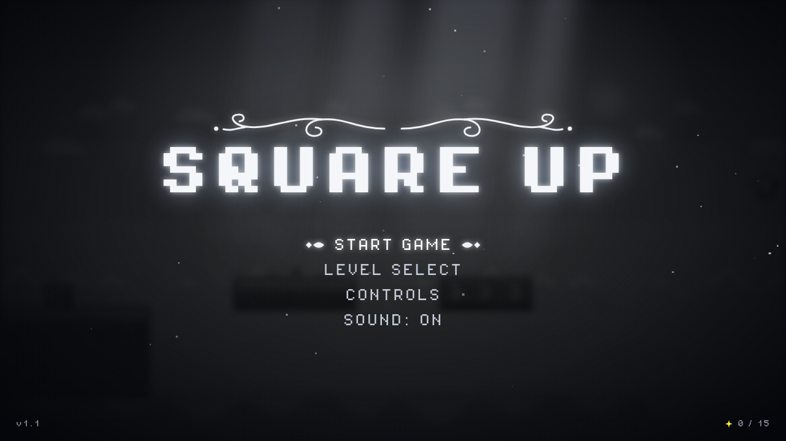
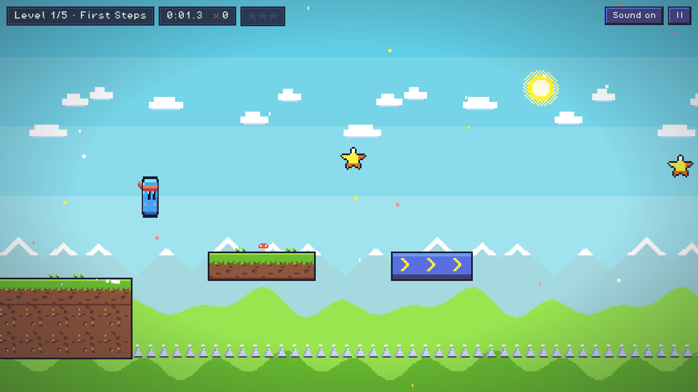
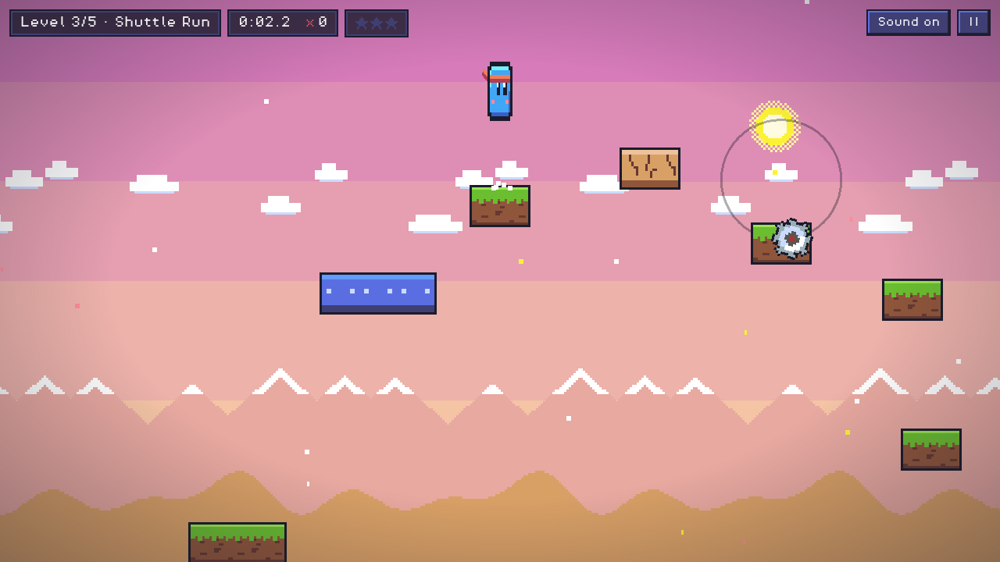
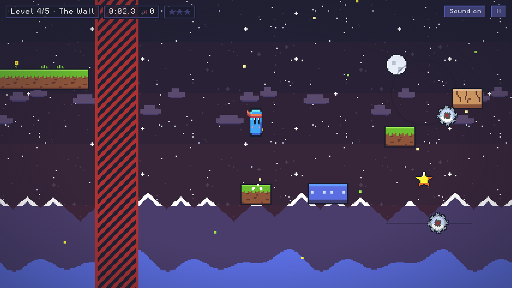

# Square Up

A small pixel-art platformer in five levels, written in TypeScript with three.js for drawing and
p2-es for physics. No framework, no bundler and no npm: the libraries are files in `lib/`, the
compiler is a binary in `lib/`, and a Makefile builds it.

| | |
| --- | --- |
|  |  |
|  |  |

## Download and play

Grab the program for your system from the
[latest release](https://github.com/kamm3r/square-up/releases/latest) and run it. It opens the
game in your browser; keep its window open while you play.

- **Windows:** `square-up-windows-x64.exe`. Windows may warn about an unknown app: choose
  "More info", then "Run anyway".
- **macOS:** `square-up-macos-arm64` (Apple Silicon) or `square-up-macos-x64` (Intel). The program
  isn't signed, so the first time, run `xattr -d com.apple.quarantine square-up-macos-*` and
  `chmod +x square-up-macos-*` in Terminal, then open it.
- **Linux:** `square-up-linux-x64` or `square-up-linux-arm64`; `chmod +x` it, then run it.

## Build and play from source

```
make deps     # once: downloads three.js, p2-es and the TypeScript compiler into lib/
make serve    # compiles, then serves on http://localhost:5317
```

You need `curl` and `tar` for `make deps`, and `node` for `make serve`. The dev server is
`tools/serve.ts`, compiled with the rest; ES modules can't load from `file://`, so the game always
needs a server, and this one makes the browser pick up every rebuild on a plain refresh.
`make watch` recompiles on every save.

`make dist` (needs `go`) builds the downloadable programs into `dist/`. Each one is
`launcher/main.go` with the game files packed inside: it serves them on `127.0.0.1:47317` and
opens the browser there.

## Layout

```
index.html        the page; its import map points `three` and `p2-es` at lib/
style.css         menus and HUD
src/              the game (TypeScript)
  main.ts           renderer, camera and the frame loop
  game/levels.ts    every level layout
  game/sim.ts       physics and game rules, knows nothing about drawing
  game/scene/       three.js drawing: background, world objects, player, particles
  ui/overlay.ts     HTML menus and HUD
public/           sounds and fonts
lib/              third-party code, like a C/C++ include folder (see tools/fetch-deps.sh)
build/            compiler output, loaded by index.html
tools/            dependency download script and the level-check bot
launcher/         the downloadable program (Go), built by `make dist`
docs/             screenshots for this README
```

## Checking levels

`make check-levels` (needs node) runs a bot through every level, once on the main path and once
collecting all stars, with input limited to what a person can press. Run it after changing a level.
